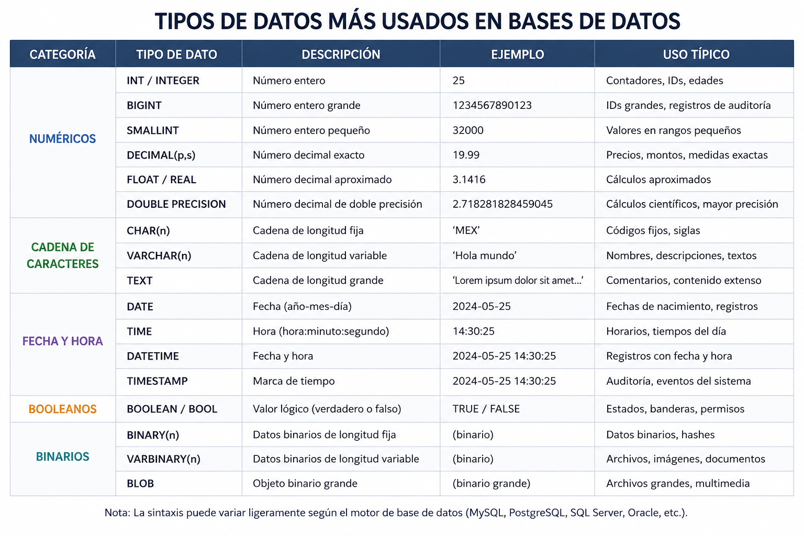

# Blue Lock SQL Project  
## Modelado de _Bases de Datos_ 
### Tipos de Datos: 
- Los `atributos de las entidades` deben cumplir o pueden ser únicamente de ciertos tipos de datos. Entre ellos, los más **_importantes/utilizados_** son:  
  
    - `Numéricos (int o double)`: Se utilizan para represntar valores/atributos de carácter numéricos tanto enteros, como decimales. 
  
    - `Texto (Varchar)`: Se utiliza para representar valores de texto, como ser cadenas de caracteres, palabras, etc. 
  
    - `Date (Fecha)`: Se utiliza para representar fechas, horas, minutos, segundos, etc. 
  
    - `Boolean ("Buleano" o Lógico)`: Se utiliza para representar valores o verdaderos o falsos **_(true or false)_**. 

### Imagen de _Tipos de Datos_ 

---
## Primary y Foreign _Keys_

Para poder lograr `relaciones entre tablas`, cada elemento de cada tabla debe identificarse de forma `ÚNICA`, de forma tal que, al relacionar tablar no hay confusiones entre `valores repetidos`.

- `Las claves primarias (Primary Key)`: son valores que identifican de **_manera única_** a cada fila o registro de una tabla, esto quiere decir `no se puede repetir`. Por ejemplo: Un **_número de cliente_**. 

- `Las claves foráneas (Foreign Key)`: es un campo de una **"_tabla X_"** que sirve para enlazar o relacionar entre sí con otra **"_tabla Y_"** en la cual el campo de esta tabla es una llave primaria _(Primary Key)_. Es decir, **"una _clave foránea_ en una tabla, es la _clave primaria_ en otra"**.

---