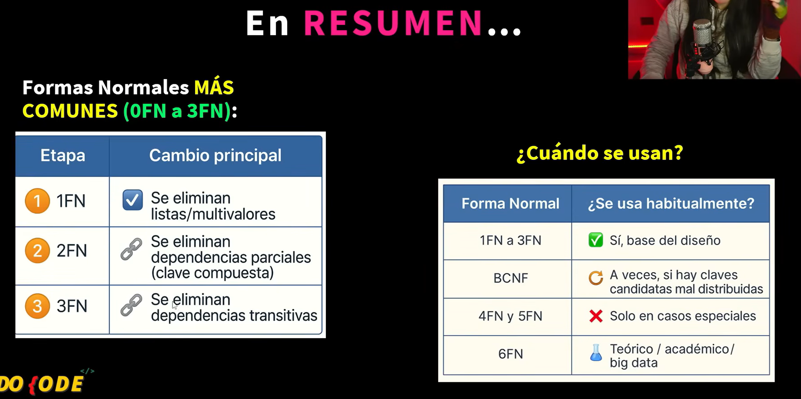

# Blue Lock SQL Project  
## ¿Qué es la _Normalización_? 
- La `Normalización` es un proceso que se aplica al `diseño de bases de datos relacionales`, principalmente para: 

  - `Eliminar` redundancia de datos. 
  
  - `Evitar` anomalías en operaciones de inserción, actualizacón y eliminación. 

  - `Garantizar` la integridad de los datos. 

- Es una técnina propuesta por **Edgar F. Codd**, el creador del `modelo relacional`. 

--- 
## Zero Normal Form _(Forma Normal 0)_ _(0FN)_ 
- Es el **_estado inicial_**, sin aplicar ninguna regla de `normalización`. 

    | id_empleado | nombre     | departamento | idiomas                   | 
    |-------------|------------|--------------|---------------------------|
    |1            | Ana Gómez  | RRHH         | Inglés, Francés           |
    |2            | Juan Perez | Sistemas     | Inglés                    |
    |3            | Laura Díaz | Marketing    | Alemán, Inglés, Portugués |

- **Problemas:** 
  - Los idiomas están en una lista **->** no son atómicos. 
  - Repeticiones y posibles errores en escritura. 

--- 
## First Normal Form _(Primera Forma Normal)_ _(1FN)_

**Condiciones:**  
  - Requiere que los atributos sean **atómicos** _(no repetitivos, no multivaluados)_. 
  
  - No debe haber listas ni conjuntos como valores en un atributo. 

    | id_empleado | nombre      | departamento | idiomas        | 
    |-------------|-------------|--------------|----------------|
    |1            | Ana Gómez   | RRHH         | Inglés         |
    |1            | Ana Gómez   | RRHH         | Francés        |
    |2            | Juan Perez  | Sistemas     | Inglés         |
    |3            | Laura Díaz  | Marketing    | Alemán         |
    |3            | Laura Díaz  | Marketing    | Inglés         |
    |3            | Laura Díaz  | Marketing    | Portugués      | 

  - **Problemas:**
    - Redundancia en nombre y departamento por empleado. 
    - Escalabilidad limitada si se agregan más atributos por empleado. 

--- 
## Second Normal Form _(Segunda Forma Normal)_ _(2FN)_ 

**Condiciones:**
  - Aplica a tablas que **_ya están en 1FN_** y exige que todos los atributos dependan de toda la `clave primaria (PK)` _(no de una parte => evitar dependencia parcial)_. 
  
  - Eliminar dependencias parciales si la clave es compuesta.  
  
  - "Detectamos" la necesidad de descomponer la tabla porque existen **dependencias parciales**: algunos **_atributos dependen únicamente de una parte de la clave primaria compuesta_**. 
    
    | id_empleado | nombre     | departamento |  
    |-------------|------------|--------------|
    |1            | Ana Gómez  | RRHH         |
    |2            | Juan Perez | Sistemas     |
    |3            | Laura Díaz | Marketing    |

    | id_empleado | idioma    | 
    |-------------|-----------|
    | 1           | Inglés    | 
    | 1           | Francés   | 
    | 2           | Inglés    | 
    | 3           | Alemán    |   
    | 3           | Inglés    |
    | 3           | Portugués |

  - **Mejoras:** 
    - Eliminamos duplicación de nombres y departamentos. 
    - Eliminamos las dependencias parciales.
  
  - **Problemas:**
    - Es un diseño **no normalizado** a nivel de modelado **debido a la mezcla de entidades conceptuales** _(Empleado y Departamento)_ dentro de una misma tabla. Esto puede **generar redundancia** de _datos y anomalías de actualización_, ya que **la información del departamento se repite innecesariamente en cada empleado**. 

---
## Third Normal Form _(Tercera Forma Normal)_ _(3FN)_ 

**Condiciones:**
  - Aplica a tablas que **_ya están en 2FN_** y exige que no hay **_dependencias transitivas_** _(atributos X que es determinado por un atributo Y que es determinado por el PK)_. 
  - Eliminar **dependencias transitivas**.

    | id_empleado | nombre     | id_departamento |  
    |-------------|------------|-----------------|
    |1            | Ana Gómez  | 1               |
    |2            | Juan Perez | 2               |
    |3            | Laura Díaz | 3               |

    | id_departamento | nombre_departamento | 
    |-----------------|---------------------|
    | 1               | RRHH                |
    | 2               | Sistemas            |
    | 3               | Marketing           |

    | id_empleado | idioma    | 
    |-------------|-----------|
    | 1           | Inglés    | 
    | 1           | Francés   | 
    | 2           | Inglés    | 
    | 3           | Alemán    |   
    | 3           | Inglés    |
    | 3           | Portugués |

  - **Mejoras:** 
    - Si agregamos un nuevo empleado, no se repite el nombre del departamento. 

--- 
## Boyce-Codd Normal Form _Boyce Cood Forma Normal_ _(BCFN)_ 
- Es una forma **normal independiente** y más **_estricta que 3FN_**.

**Regla:** 
  - Para toda dependencia funcional `X -> Y`, _(en caso de que no sea **dependencia funcional trivial**)_ `x` debe de ser `superclave`. 

**EJM:** 
  - **_Reglas del Negocio_** 
    - Cada aula tiene asignado a un **_único docente_**. 

  | Curso  | Aula | Docente |
  | ------ | ---- | ------- |
  | Java   | A1   | Pedro   |
  | SQL    | A1   | Pedro   |
  | Python | A2   | María   |

- **Dependencias:** 
  - `curso -> aula` 
  - `aula -> docente`  _(por las reglas del negocio deducimos esto)_

- La **_superclave_** y **_clave candidata_** es `curso` 
- Entonces revisando las dependencias vemos que `aula -> docente` violan la `BCFN` pues la detemrinante `aula` no es **_superclave_**. 

**Solución:** 
- Separar **Tablas** 
- **Cursos** 

  | Curso  | Aula |
  | ------ | ---- |
  | Java   | A1   |
  | SQL    | A1   |
  | Python | A2   |

- **aulas** 

  | Aula | Docente |
  | ---- | ------- |
  | A1   | Pedro   |
  | A2   | María   |

--- 
## ¿Hasta qué _Forma Normal_ Llegar? 
- Lo ideal en la mayoría de los sistemas es hasta **3FN** porque:  
  - Elimina redundancias innecesrias. 
  - Previene anomalías en inserción, eliminación y actualización. 
  - Mantiene un equilibrio entre integridad de datos y rendimiento. 

- ¿Y la **_Cuarta Forma Normal u otras_**? 
  - Se aplican si: 
    - Hay relaciones multivaluadas independientes. 
    - Se requiere un diseño muy riguroso y limpio, como en aplicaciones críticas. 
    - Se busca un modelo académicamente correcto o como base para automatización. 

  - No siempre se aplican si: 
    - El sistema necesita rendimiento por encima de integridad (reportes). 
    - Se aceptan algunas redundancias controladas para evitar **JOINs** costosos. 
    - Estás en un entorno de lectura intensiva, como **Data Warehouse** _(donde se suele desnormalizar)_. 

---

---
## EJM Genaral 
- **0FN** 
  
  | id_piloto | nombre           | lenguajes        | Instructor     | aula   | 
  |-----------|------------------|------------------|----------------|--------|
  | 1         | Max Verstappen   | Java, Python     | García, Férnan | A1, B2 |
  | 2         | Charles Leclerc  | Java             | García         | A1     |
  | 3         | Lewis Hamilton   | JavaScript, Java | López, García  | C3, A1 |  
  | 4         | Franco Colapinto | Java             | García         | A1     |

- **1FN** 

  | id_piloto | nombre           | lenguajes        | Instructor     | aula   | 
  |-----------|------------------|------------------|----------------|--------|
  | 1         | Max Verstappen   | Java             | García         | A1     |
  | 1         | Max Verstappen   | Python           | Férnan         | B2     |
  | 2         | Charles Leclerc  | Java             | García         | A1     |
  | 3         | Lewis Hamilton   | JavaScript       | López          | C3     |  
  | 3         | Lewis Hamilton   | Java             | García         | A1     |  
  | 4         | Franco Colapinto | Java             | García         | A1     |

- **2FN** 

  | id_piloto | nombre           | 
  |-----------|------------------|
  | 1         | Max Verstappen   | 
  | 2         | Charles Leclerc  | 
  | 3         | Lewis Hamilton   |  
  | 4         | Franco Colapinto | 

  | id_lenguaje | lenguaje         | Instructor     | aula   | 
  |-------------|------------------|----------------|--------|
  | 1           | Java             | García         | A1     |
  | 2           | Python           | Férnan         | B2     |
  | 3           | JavaScript       | López          | C3     |  

  | id_piloto | id_lenguaje   | 
  |-----------|---------------|
  | 1         | 1             |
  | 1         | 2             |
  | 2         | 1             |
  | 3         | 3             |  
  | 3         | 1             |  
  | 4         | 1             |

- **3FM** 

  | id_piloto | nombre           | 
  |-----------|------------------|
  | 1         | Max Verstappen   | 
  | 2         | Charles Leclerc  | 
  | 3         | Lewis Hamilton   |  
  | 4         | Franco Colapinto | 

  | id_lenguaje | lenguaje         | 
  |-------------|------------------|
  | 1           | Java             |
  | 2           | Python           |
  | 3           | JavaScript       |  

  | id_instructor | Nombre         | aula   | 
  |---------------|----------------|--------|
  | 1             | García         | A1     |
  | 2             | Férnan         | B2     |
  | 3             | López          | C3     |

  | id_instructor | id_lenguaje      | 
  |---------------|------------------|
  | 1             | 1                |
  | 2             | 2                |
  | 3             | 3                |  

  | id_piloto | id_lenguaje   | 
  |-----------|---------------|
  | 1         | 1             |
  | 1         | 2             |
  | 2         | 1             |
  | 3         | 3             |  
  | 3         | 1             |  
  | 4         | 1             |

--- 
