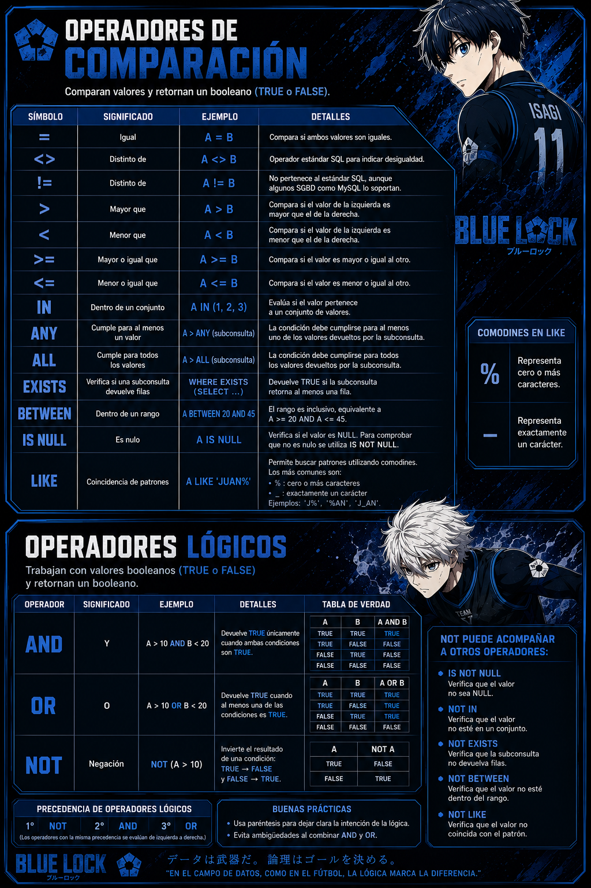

# Blue Lock SQL Project  
## Operadores en _SQL_ 
- Tenemos **DOS** tipos de `operadores` en `SQL`, uno de `comparación` y otro de `lógica`. 

---

## Operadores de _Comparación_ 
- Los `operadores de comparación` son aquellos que _evaluan_ o mejor dicho **_comparan_** directamente con el valor y retornan un `booleano`.  

**Entre ellos se encuentran:** 
| **Símbolo** | **Significado**   | **Ejemplo**  | **Detalles** |
|-------------|-------------------|--------------|--------------|
| `=`         | Igual             | `A = B`      | Compara si ambos valores son iguales. |
| `>`         | Mayor que         | `A > B`      | Compara si el valor de la izquierda es mayor que el de la derecha. |
| `<`         | Menor que         | `A < B`      | Compara si el valor de la izquierda es menor que el de la derecha. |
| `>=`        | Mayor o igual que | `A >= B`     | Compara si el valor es mayor o igual al otro. |
| `<=`        | Menor o igual que | `A <= B`     | Compara si el valor es menor o igual al otro. |
| `<>`        | Distinto de        | `A <> B`    | Operador estándar SQL para indicar desigualdad. |
| `!=`        | Distinto de        | `A != B`     | **No pertenece al estándar SQL**, aunque algunos SGBD como MySQL lo soportan. |
| `IN`        | Dentro de un conjunto | `A IN (1, 2, 3)` | Evalúa si el valor pertenece a un conjunto de valores. |
| `ANY`       | Cumple para al menos uno | `A > ANY (conjunto)` | La condición debe cumplirse para **al menos uno** de los valores devueltos por la subconsulta. |
| `ALL`       | Cumple para todos | `A > ALL (conjunto)` | La condición debe cumplirse para **todos** los valores devueltos por la subconsulta. |
| `EXISTS`    | Verifica si una subconsulta devuelve filas | `WHERE EXISTS (SELECT ...)` | Devuelve `TRUE` si la subconsulta retorna **al menos una fila**. |
| `BETWEEN`   | Dentro de un rango | `A BETWEEN 20 AND 45` | El rango es **inclusivo**, equivalente a `A >= 20 AND A <= 45`. |
| `IS NULL`   | Es nulo | `A IS NULL` | Verifica si el valor es `NULL`. Para comprobar que **no** es nulo se utiliza `IS NOT NULL`. |
| `LIKE`      | Coincidencia de patrones | `A LIKE 'JUAN%'` | Utiliza **comodines** para buscar patrones. `%` representa **cero o más caracteres** y `_` representa **exactamente un carácter**. |

--- 
## Operadores _Lógicos_ 
- Los `operadores lógicos` son aquellos que trabajan directamente con **_valores_** `booleanos` **_(TRUE or False / 1 or 0)_** y dan como resultado un `booleano`. 

**Entre ellos se encuentran:** 
| **Operador** | **Significado** | **Ejemplo**  | **Detalles**|
|:------------:|-----------------|------------------------------|----------------|
| `AND`        | Y               | `A > 10 AND B < 20`          | Devuelve `TRUE` únicamente cuando **ambas** condiciones son `TRUE`.                             |
| `OR`         | O               | `A > 10 OR B < 20`           | Devuelve `TRUE` cuando **al menos una** de las condiciones es `TRUE`.                           |
| `NOT`        | Negación        | `NOT (A > 10)`               | Invierte el resultado de una condición: `TRUE → FALSE` y `FALSE → TRUE`.                     |

--- 
## Imágenes Explicativas 

