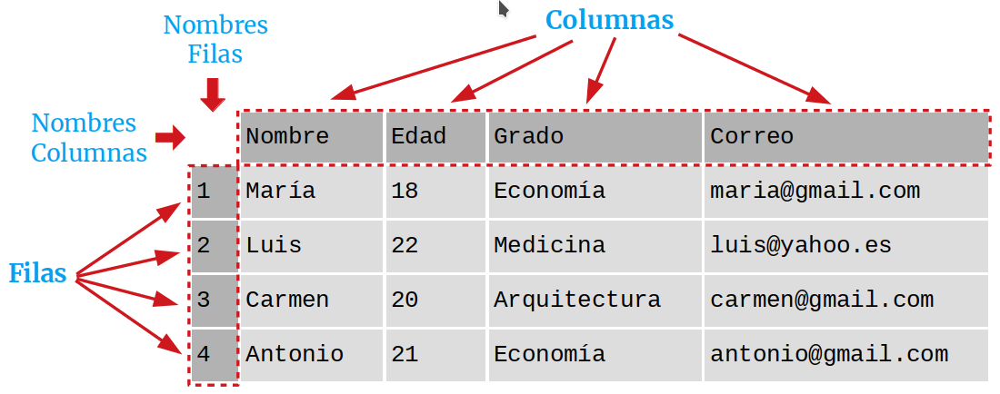
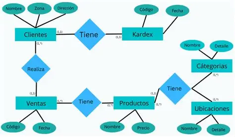
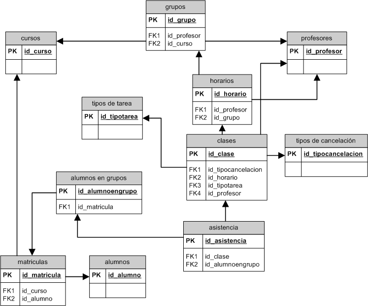

# Blue Lock SQL Project 
## ¿Qués es una _Base de Datos_? 

- Una **_Base de Datos_** es un `conjunto de datos` pertenecientes a un mismo contexto y almacenados `sistemáticamente` para su posterior uso.
  
- Pueden ser datos cuyo contenido o temática `difieren entre si`, pero que poseen `relaciones en común.`

- **Por ejemplo:**
  - Una lista de alumnos no tiene `nada que ver con una lista de libros`. Pero si un alumno desea retirar los libros de una biblioteca, `existe una relación.`
  
--- 
### ¿Qué es *Sistemáticamente*? 
- Cuando decimos que los datos de una **Base de Datos** se almacena  `sistemáticamente`, queremos decir que son guardados siguiendo una `organización`, `estructura` y `reglas definidas.`

### Ahora... ¿Qué es un _Sistema_?
- En `Informática`, un **sistema** es un conjunto de elementos que interactuan entre sí con el fin de cumplir un mismo `objetivo.`

--- 
## ¿Dónde están las _Bases de Datos_? 
- Las `Bases de Datos` se encuentran en el `nivel más bajo (capa fundamental, donde se almacena los datos)` dentro de un entorno de un sistema de **bases de datos.**
  
- Generalmente se los considera como `parte física`, ya que, aunque sean un contenido _lógico_, se encuentra almacenadas o creadas en un `dispositivo físico`. Por ejemplo: _Un servidor_.
  
- Para que un usuario pueda acceder a los datos en una _Base de Datos_, necesita de un Software especial conocido como `SGBD (Sistema Gestor de Bases de Datos)` o `DBMS (Data Base Managment System)`. 

### ¿Qué es un _Sistema de Bases de Datos_? 
- **OJO:** `Base de Datos != Sistema de Bases de Datos`.  
- Una Base de Datos es solo un conjunto de datos organizados. Por Ejemplo: 
  ```text 
  BD Biblioteca 
  |- Alumno 
  |- Libro 
  |- Prestamo
  ```
- Mientras que un `Sistema de Bases de Datos` incluye más componentes: 
  ```text 
  Sistema de Bases de Datos 
  |- Bases de Datos 
  |- SGDB / DBMS (MySQL, PostgreSQL, SQL Server)
  |- Usuarios
  |- Aplicaciones 
  |- Procedimientos de administración
  ```

- Como si _Fuera un edificio:_ 
  ```text 
  Piso 3 -> Usuarios 
  Piso 2 -> Aplicación 
  Piso 1 -> PostgreSQL 
  Sótano -> Datos Almacenados
  ```
--- 
## ¿Qué es un _Servidor de Bases de Datos_? 
- Un `servidor` es una computadora que ofrece `servicios o recursos` a otras computadoras, llamadas **_clientes_**, a través de una red _(como internet o una red local)_. 
  
- Un `servidor de bases de datos` es justamente una computadora _(local o remota)_ que se encarga de almacenar, organizar y permitir el acceso a datos de forma segura y eficiente. 
  
- El `servidor` de _Bases de Datos_ es quien `tiene instalado dentro al SGBD / DBMS`. 

- Por ejemplo: Puedo tener un servidor con _PostgreSQL_, otro con _Oracle_, otro con un _Gestor para Base de Datos no relacional_, etc. 

- En el caso de **PostgreSQL**, al SGBD se lo administra normalmente con: 
  - `psql` _(cliente de línea de comandos oficial)_.
  - `pgAdmin` _(interfaz gráfica oficial)_.
  - `DBeaver`, `DataGrip` u otros clientes compatibles. 

- Para poder usar _Bases de Datos_ tenemos que contar o instalar un `servidor`. 

--- 
## Abstracción y Modelación 
- La `abstracción de datos`, por lo general, significa lograr una forma de representación lógica de las situaciones y objetos del mundo real.

- Un `modelo de datos` es el proceso que a mí me permite tener los medios necesarios para lograr la  **_abstracción_**.

--- 
## Modelado de _Bases de Datos_ 
### Modelo Relacional
  - Es un modelo lógico de cómo se guardan los datos en una _Base de Datos_. 

  - Organiza los datos en **tablas** _(relaciones)_ con **filas** _(tuplas)_ y **columnas** _(atributos)_. 

  - Se usa directamente en los `SGBD / DBMS` como **_MySQL_**, **_PostgreSQL_**, **_Oracle_**, etc.

  - Es como _ves_ los datos cunado los consultas con **_SQL_**. 

### Modelo Entidad-Relación 
  - Es un modelo conceptual, pensado para `diseñar/dibujar` una **_Base de Datos_** antes de crearla. 
  
  - Usa `entidades`, `atributos`, y `relaciones entre ellas`. 
  
  - Se representa gráficamente con **DER** _(diagrama entidad relación)_. 
  
  - Te ayuda a entender la lógica del sistema sin pensar aún en tablas. 


### Imgen del _Modelo Relacional_ 


### Imagen del _Modelo Entidad Relación_ 


### Imagen del _Modelo Entidad Relación Moderna_ 


--- 
