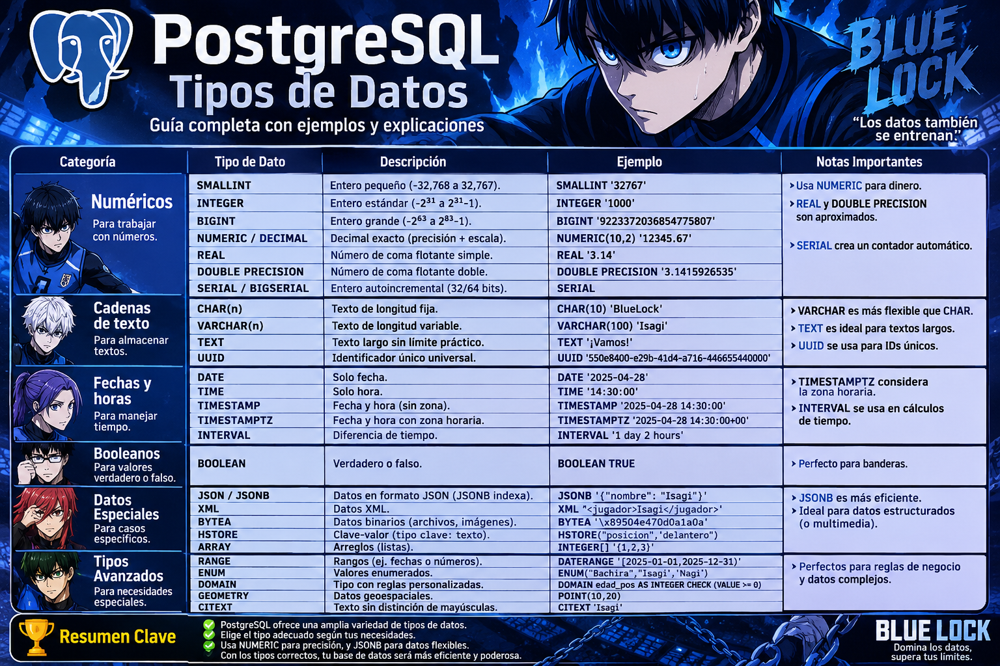

# Blue Lock SQL Project  
## Modelado de _Bases de Datos_ 
### Tipos de Datos en _PostgreSQL_: 
- Los `atributos de las entidades` deben cumplir o pueden ser únicamente de ciertos tipos de datos. Entre ellos, los más **_importantes/utilizados_** en PostgreSQL son:  
  
    - `Numéricos`: Se utilizan para representar valores/atributos de carácter numérico, tanto enteros como decimales.  
      - `SMALLINT`: entero pequeño (2 bytes).  
      - `INTEGER` / `INT`: entero (4 bytes).  
      - `BIGINT`: entero grande (8 bytes).  
      - `NUMERIC(p, s)` / `DECIMAL(p, s)`: decimal **exacto** (precios, montos).  
      - `REAL`: decimal aproximado de precisión simple.  
      - `DOUBLE PRECISION`: decimal aproximado de doble precisión.  
  
    - `Texto`: Se utiliza para representar valores de texto, como cadenas de caracteres, palabras, etc.  
      - `CHAR(n)`: longitud fija.  
      - `VARCHAR(n)`: longitud variable con límite.  
      - `TEXT`: longitud variable sin límite práctico (es el más usado en PostgreSQL).  
  
    - `Fecha y hora`: Se utiliza para representar fechas, horas, minutos, segundos, etc.  
      - `DATE`: solo fecha.  
      - `TIME`: solo hora.  
      - `TIMESTAMP`: fecha y hora **sin** zona horaria.  
      - `TIMESTAMPTZ` (`TIMESTAMP WITH TIME ZONE`): fecha y hora **con** zona horaria (recomendado en PostgreSQL).  
      - `INTERVAL`: duración o diferencia entre fechas.  
  
    - `Boolean ("Buleano" o Lógico)`: Se utiliza para representar valores verdaderos o falsos **_(true or false)_**. En PostgreSQL el tipo es `BOOLEAN` y acepta `TRUE`, `FALSE` y `NULL` (también `'t'` / `'f'`).  
  
    - `Binarios`: `BYTEA` se utiliza para almacenar datos binarios (archivos, imágenes, hashes).  
  
    - `Otros tipos propios de PostgreSQL`:  
      - `UUID`: identificadores únicos universales.  
      - `JSON` / `JSONB`: documentos JSON (JSONB es la versión binaria indexable).  
      - `ARRAY`: arreglos de cualquier tipo (`INTEGER[]`, `TEXT[]`, etc.).  
      - `ENUM`: enumeraciones creadas con `CREATE TYPE ... AS ENUM`.  

### Autoincremento en _PostgreSQL_
- PostgreSQL **no usa `AUTO_INCREMENT`**. Para generar valores consecutivos automáticamente se utiliza:  
  - `GENERATED ALWAYS AS IDENTITY` _(estándar SQL, recomendado en versiones modernas)_:  
    ```sql
    CREATE TABLE usuarios(
        id INTEGER GENERATED ALWAYS AS IDENTITY PRIMARY KEY,
        nombre VARCHAR(50)
    );
    ```
  - `SERIAL` / `BIGSERIAL` _(forma clásica de PostgreSQL, crea una secuencia interna)_:  
    ```sql
    CREATE TABLE usuarios(
        id SERIAL PRIMARY KEY,
        nombre VARCHAR(50)
    );
    ```

### Equivalencias que suelen confundir
| En MySQL / SQL Server | En PostgreSQL |
| --- | --- |
| `AUTO_INCREMENT` | `GENERATED ... AS IDENTITY` o `SERIAL` |
| `DATETIME` | `TIMESTAMP` (o `TIMESTAMPTZ`) |
| `TINYINT` | `SMALLINT` (no existe `TINYINT`) |
| `BLOB` | `BYTEA` |
| `BINARY(n)` / `VARBINARY(n)` | `BYTEA` |
| `DOUBLE` | `DOUBLE PRECISION` |
| `BOOL` | `BOOLEAN` |

### Imagen de _Tipos de Datos_ 


---
## Primary y Foreign _Keys_

Para poder lograr `relaciones entre tablas`, cada elemento de cada tabla debe identificarse de forma `ÚNICA`, de forma tal que, al relacionar tablas no hay confusiones entre `valores repetidos`.

- `Las claves primarias (Primary Key)`: son valores que identifican de **_manera única_** a cada fila o registro de una tabla, esto quiere decir `no se puede repetir`. Por ejemplo: Un **_número de cliente_**. 

- `Las claves foráneas (Foreign Key)`: es un campo de una **"_tabla X_"** que sirve para enlazar o relacionar entre sí con otra **"_tabla Y_"** en la cual el campo de esta tabla es una llave primaria _(Primary Key)_. Es decir, **"una _clave foránea_ en una tabla, es la _clave primaria_ en otra"**.

---
