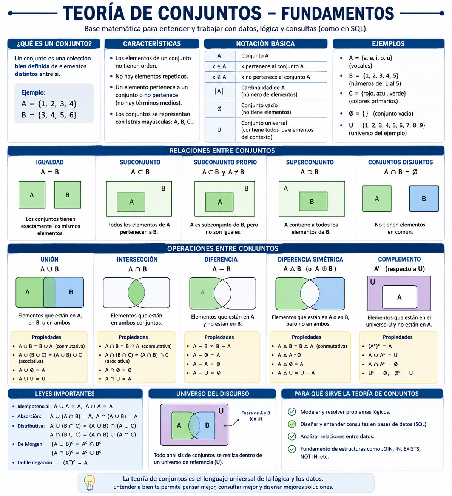
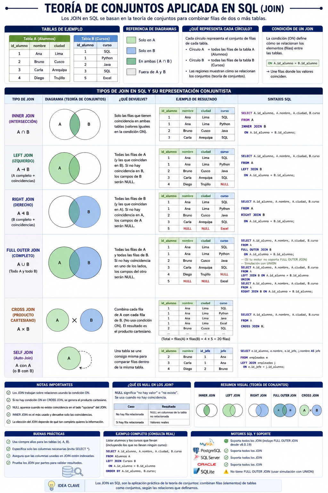
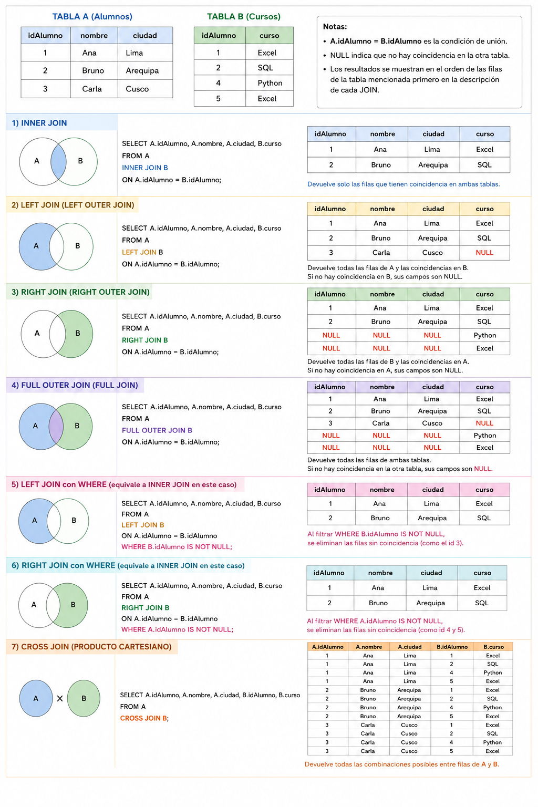
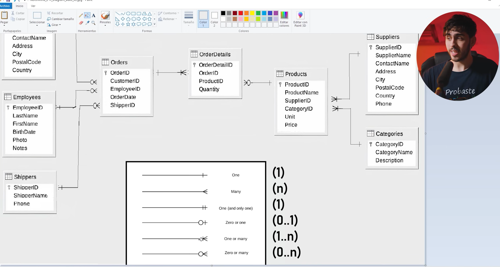

# Blue Lock SQL Project  
## ¿Qué es _JOIN_? 
- La sentencia `JOIN` permite la combinación entre registros de una o más tablas con la finalidad de poder unificar datos. Además usa la `Toería de Conjuntos`.  

- En `SQL` hay distitnos tipos de `JOINS`, entre los más usados: 
  
  - `INNER JOIN` 
  - `LEFT JOIN`
  - `RIGHT JOIN`
  - `FULL JOIN`

## Imagen de _Teoría de Conjuntos_


## Imagen de _Teoría de Conjuntos en SQL V1_
- Esta imagen presente un error en `RIGHT JOIN` en el campo de `id_alumno`, pues debía de ser `NULL`, dicho error se resuelve en la `Imagen V2`. 



## Imagen de _Teoría de Conjuntos en SQL V2_
- Esta imagen presente la correción del `RIGHT JOIN` de la anterior imagen en el campo de `id_alumno` que debería de ser `NULL`, además cosas nuevas como `LEFT JOIN` con `WHERE` y `RIGHT JOIN` con `WHERE` dando como resultado un `INNER JOIN`.


--- 

## Inner Join 
- En la sentencia `INNER JOIN` sólo se muestra los registros que coincidan tanto en la tabla **A** como en la tabla **B**.  

- Existen dos formas de darlo a conoer: 
  - Forma `Implícita`. 
  - Forma `Explícita`.

  - EJM de Forma `IMPLÍCITA`:
    ```SQL 
    -- IMPLÍCITO 
    select * from empleados, departamento 
    where empleados.id_departamento = departamento.id
    order by empleados.id desc;
    ```  

  - EJM de Forma `EXPLÍCITA`: 
    ```SQL 
    -- Explícita 
    select 
    empleados.id as id_empleado,
    empleados.nombre as nombre_empleado,
    empleados.dni, 
    empleados.edad, 
    empleados.estado,
    empleados.email,
    empleados.num_telefono as telefono,
    empleados.cargo,
    departamento.id as id_departamento,
    departamento.nombre as nombre_departamento, 
    departamento.edificio,
    departamento.piso
    from empleados 
    inner join departamento 
    on empleados.id_departamento = departamento.id
    -- where empleados.estado = 0
    order by id_departamento asc , empleados.edad asc;
    ```
--- 
## LEFT JOIN
- Muestra el conjunto completo de los registros de la tabla **A**, con los registros que coincidad de la tabla **B** _(si es que las hay)_, en caso de no coincidir se completa con **_NULL_**. 

  - EJM de `LEFT JOIN`: 
    ```SQL
        -- LEFT JOIN 
    select 
    empleados.id as id_empleado,
    empleados.nombre as nombre_empleado,
    empleados.dni, 
    empleados.edad, 
    empleados.estado,
    empleados.email,
    empleados.num_telefono as telefono,
    empleados.cargo,
    departamento.id as id_departamento,
    departamento.nombre as nombre_departamento, 
    departamento.edificio,
    departamento.piso
    from empleados 
    left join departamento 
    on empleados.id_departamento = departamento.id
    -- where empleados.estado = 0
    order by id_departamento asc , empleados.edad asc;
    ```
--- 
## RIGHT JOIN 
- Es el **"reflejo"** del `LEFT JOIN`. Muestra el conjunto completo de los registros de la tabla **B**, con los registros que coincidadn de la tabla **A** _(si es que las hay)_, en caso de no coincidir se completa con **_NULL_**.
  
  - EJM de `RIGHT JOIN`: 
    ```SQL 
    -- RIGHT JOIN 
    select 
    empleados.id as id_empleado,
    empleados.nombre as nombre_empleado,
    empleados.dni, 
    empleados.edad, 
    empleados.estado,
    empleados.email,
    empleados.num_telefono as telefono,
    empleados.cargo,
    departamento.id as id_departamento,
    departamento.nombre as nombre_departamento, 
    departamento.edificio,
    departamento.piso
    from empleados 
    right join departamento 
    on empleados.id_departamento = departamento.id
    -- where empleados.estado = 0
    order by id_departamento asc , empleados.edad asc, nombre_empleado asc;
    ```
--- 
## FULL JOIN 
- Esta sentencia muestra todos lo resultados de tabla **A** y la tabla **B** aunque alguna no tengna correspondencia en la otra tabla _(completa con NULL)_. 

  - EJM de `FULL JOIN`: 
    ```SQL 
    -- FULL JOIN 
    select 
    empleados.id as id_empleado,
    empleados.nombre as nombre_empleado,
    empleados.dni, 
    empleados.edad as edad_empleado, 
    empleados.estado,
    empleados.email,
    empleados.num_telefono as telefono,
    empleados.cargo,
    departamento.id as id_departamento,
    departamento.nombre as nombre_departamento, 
    departamento.edificio,
    departamento.piso
    from empleados 
    full join departamento 
    on empleados.id_departamento = departamento.id
    ```
  
  - **PostgreSQL soporta `FULL JOIN` / `FULL OUTER JOIN` de forma nativa**, así que no hace falta simularlo. La simulación con `UNION` de `LEFT JOIN` y `RIGHT JOIN` se usa en gestores que **no** lo soportan (por ejemplo, MySQL): 
    ```SQL 
    -- UNION (SIMULAR EL FULL OUTER JOIN)
    select 
    empleados.id as id_empleado,
    empleados.nombre as nombre_empleado,
    empleados.dni, 
    empleados.edad as edad_empleado, 
    empleados.estado,
    empleados.email,
    empleados.num_telefono as telefono,
    empleados.cargo,
    departamento.id as id_departamento,
    departamento.nombre as nombre_departamento, 
    departamento.edificio,
    departamento.piso
    from empleados 
    left join departamento 
    on empleados.id_departamento = departamento.id
    -- where empleados.estado = 1
    union
    select 
    empleados.id as id_empleado,
    empleados.nombre as nombre_empleado,
    empleados.dni, 
    empleados.edad edad_empleado, 
    empleados.estado,
    empleados.email,
    empleados.num_telefono as telefono,
    empleados.cargo,
    departamento.id as id_departamento,
    departamento.nombre as nombre_departamento, 
    departamento.edificio,
    departamento.piso
    from empleados 
    right join departamento 
    on empleados.id_departamento = departamento.id
    -- where empleados.estado = 1
    order by id_departamento asc , edad_empleado asc;
    ```
--- 
## "UNIO" and "UNION ALL" 
- Unen **_resultados_** de `consultas` 
**UNION**
- `UNION` : Junta resultados de dos consultas y elimina duplicados.

  ```SQL 
  -- FULL JOIN | FULL OUTER JOIN : SIMULADO CON "UNION" 
  -- UNION = junta resultados de dos consultas y elimina duplicados
  select * 
  from empleados as e
  left join departamento as d 
  on e.id_departamento = d.id
  union 
  select * 
  from empleados as e
  right join departamento as d 
  on e.id_departamento = d.id;
  ```

**UNION ALL** 
- `UNION ALL` : Básicamente **_une_** el resultado de `LEFT JOIN` y el de `RIGHT 
JOIN` en una sola tabla. 

- Para usalor es **OBLIGATORIO** que el resultado de las consultas tengan la **misma cantidad de columnas** y el **mismo tipo** de **columnas**.

  ```SQL 
  -- UNION ALL : Une el resultado de LEFT JOIN y el de RIGHT JOIN en una sola tabla 
  select * 
  from empleados as e
  left join departamento as d 
  on e.id_departamento = d.id
  union all
  select * 
  from empleados as e
  right join departamento as d 
  on e.id_departamento = d.id;
  ```
--- 

## IMG de _Cardinalidad_ DALTO 

--- 

## JOINs _propios de PostgreSQL_
- `CROSS JOIN`: producto cartesiano (todas las combinaciones). 
  ```sql
  SELECT * FROM empleados CROSS JOIN departamento;
  ```

- `LATERAL JOIN`: permite que una subconsulta de la derecha use columnas de la izquierda. Es como un `for each` dentro del JOIN. 
  ```sql
  SELECT e.nombre, d.nombre AS departamento, ultimo.sueldo
  FROM empleados e
  LEFT JOIN LATERAL (
      SELECT sueldo
      FROM historial_sueldos h
      WHERE h.id_empleado = e.id
      ORDER BY h.fecha DESC
      LIMIT 1
  ) AS ultimo ON TRUE;
  ```

- `NATURAL JOIN`: une por todas las columnas con el mismo nombre. **No se recomienda** en producción porque es frágil si cambia el esquema. 
  ```sql
  SELECT * FROM empleados NATURAL JOIN departamento;
  ```

--- 
