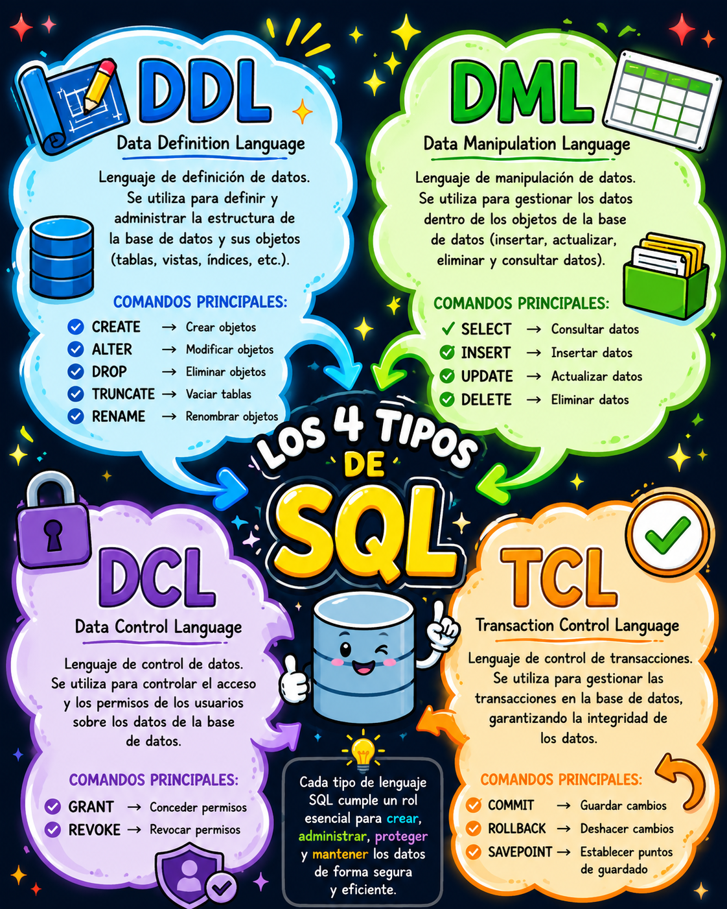
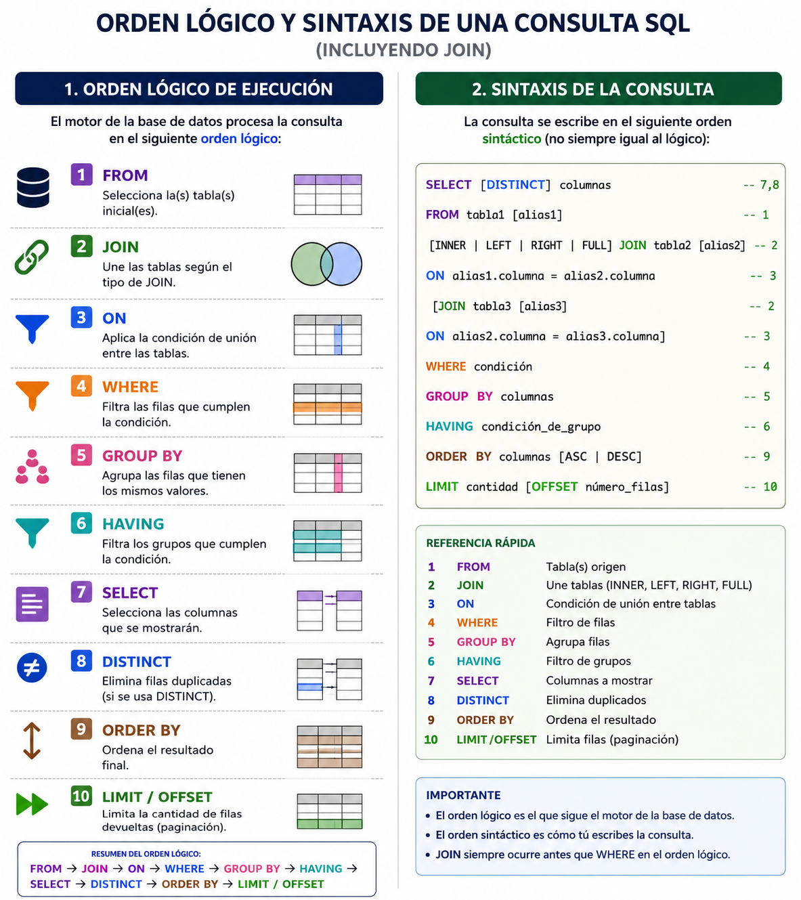
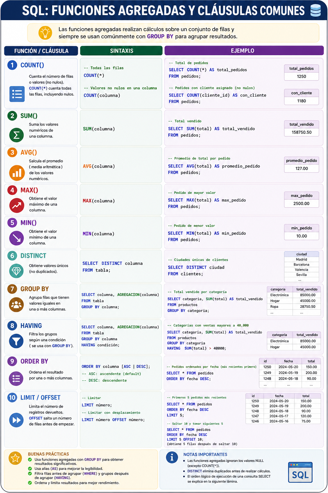
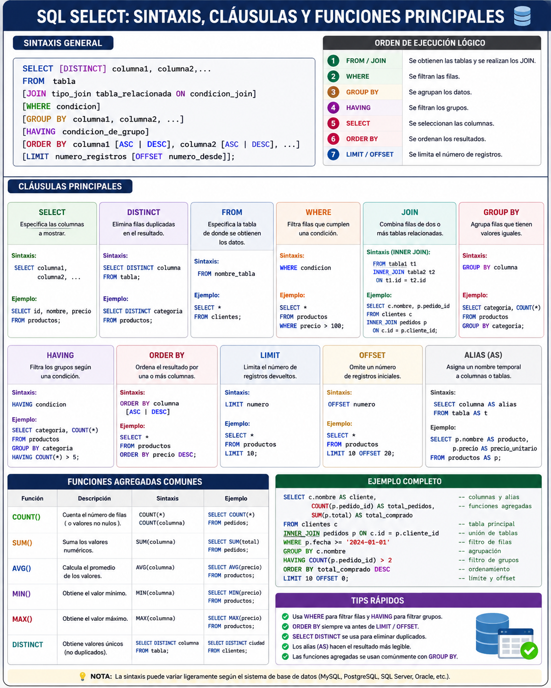

# Blue Lock SQL Project  
## ¿Qué es _SQL_?  
- `SQL (Structured Query Language)` es un lenguaje de `consultas estructuradas` para interactuar con `Bases de Datos` . 

- **SQL Te Permite:**
  - `Guardar datos` _(por ejemplo, registrar un usuario en una app)_. 
  - `Buscar datos` _(como listar todos los productos de una tienda)_.
  - `Actualizar datos` _(cambiar el precio de un producto)_.
  - `Eliminar datos` _(borrar un comentario de una red social)_.
  - `Crear o modificar estructuras` _(como agregar una nueva tabla o columna)_.


---
## ¿Qué es una _Consulta / Query_? 
- Es una `instrucción` que le das a una `Base de Datos` para que te devuelva, modifique o gestione información. 
  
- Es como hacerle una `pregunta` o darle una `orden` a la `Base de Datos` usando el lenguaje `SQL`. 

- Según lo que hacen, las consultas se agrupan en: 

| **Tipo** | **Significado** | **Ejemplos** |
| --- | --- | --- |
| **DDL** | **Lenguaje de Definición de datos** | CREATE; ALTER; DROP; TRUNCATE |
| **DML** | **Lenguaje de Manipulación de datos** | SELECT; INSERT; UPDATE; DELETE |
| **DCL** | **Lenguaje de Control de datos** | GRANT; REVOKE |
| **TCL** | **Lenguaje de Control de transacciones** | BEGIN TRANSACTION; COMMIT; ROLLBACK |



---

## Restricciones en una _Columna_: 
-  Restricciones al agregar una columna a la `tabla`: 
  
  - `NOT NULL`: indica que la columna no puede almacenar valores `NULL`, por ello, cada registro debe tener un valor en esa columna.
  
    ```sql
    CREATE TABLE usuarios(
        id INT,
        nombre VARCHAR(50) NOT NULL
    );
    ```

  - `UNIQUE`: No permite valores repetidos. 
  
    ```sql
    CREATE TABLE usuarios(
        id INT,
        correo VARCHAR(100) UNIQUE
    );
    ```
  
  - `PRIMARY KEY`: Identifica de forma única a cada registro y no admite valores `NULL` ni repetidos. 

    ```sql
    CREATE TABLE usuarios(
        id INT PRIMARY KEY,
        nombre VARCHAR(50)
    );
    ```
  
  - `FOREIGN KEY`: Estable una relación con la `PRIMARY KEY` de otra tabla. 

    ```sql
    CREATE TABLE clientes(
        id INT PRIMARY KEY,
        nombre VARCHAR(50)
    );

    CREATE TABLE pedidos(
        id INT PRIMARY KEY,
        id_cliente INT,
        FOREIGN KEY(id_cliente)
        REFERENCES clientes(id)
    );
    ```
  
  - `DEFAULT`: Asigna un valor por defecto cuando no se proporciona uno. 

    ```sql
    CREATE TABLE usuarios(
        id INT PRIMARY KEY,
        estado VARCHAR(20) DEFAULT 'Activo'
    );
    ```
  
  - `CHECK`: Obliga a que los datos cumplan una condición determinada. 
  
    ```sql
    CREATE TABLE usuarios(
        id INT PRIMARY KEY,
        edad INT CHECK (edad >= 18)
    );
    ```
  
  - `IDENTITY(1, 1)`: Genera automáticamente valores numéricos consecutivos _(empieza en 1 y suma 1)_.

    ```sql
    CREATE TABLE usuarios(
        id INT IDENTITY(1,1) PRIMARY KEY,
        nombre VARCHAR(50)
    );
    ```

  - `SEQUENCE`: Objeto independiente que genera números consecutivos y puede compartirse entre varias tablas _(SQL Server 2012+)_.

    ```sql
    CREATE SEQUENCE seq_usuarios START WITH 1 INCREMENT BY 1;

    CREATE TABLE usuarios(
        id INT PRIMARY KEY DEFAULT (NEXT VALUE FOR seq_usuarios),
        nombre VARCHAR(50)
    );
    ```

  > **OJO:** SQL Server **no tiene `AUTO_INCREMENT`** (eso es de MySQL) ni `SERIAL` ni `GENERATED ... AS IDENTITY` (eso es de PostgreSQL). Se usa `IDENTITY(1,1)` o `SEQUENCE`.

--- 

## Funciones de Agregación en _SQL_ 

En una base de datos, las funciones de agregación son herramientas poderosas dentro de las consultas SQL, ya que permiten calcular resultados sobre conjuntos de filas, en vez de operar fila a fila. Estas funciones, como `COUNT`, `SUM`, `AVG`, `MAX` y `MIN`, nos permiten resumir datos y extraer información clave, especialmente cuando combinamos estas funciones con `GROUP BY` y `HAVING`. Así, podemos agrupar, filtrar y entender grandes volúmenes de datos de una manera más clara y estructurada.

**DATO:** 
- Las funciones de agregación `(COUNT, SUM, AVG, MIN, MAX)` no pueden usarse directamente en `WHERE` porque `WHERE` filtra filas individuales antes de que `SQL` calcule las agregaciones. En ese momento todavía no existe el valor agregado, ya que este se obtiene después de agrupar las filas `(GROUP BY)` o de considerar todo el conjunto de resultados. Por ello, los **resultados de funciones de agregación** solo pueden utilizarse en `HAVING`, `SELECT`, `ORDER BY` o mediante una **subconsulta que los calcule previamente**.

### Imagenes 







---
