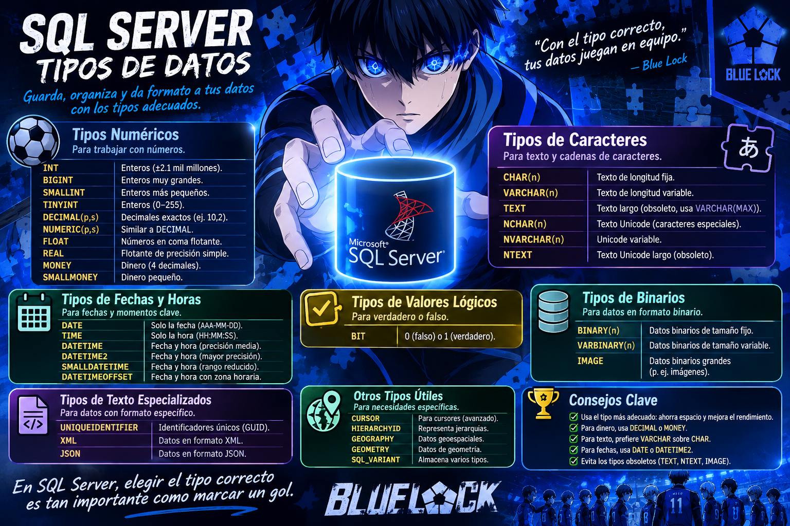

# Blue Lock SQL Project  
## Modelado de _Bases de Datos_ 
### Tipos de Datos en _SQL Server_: 
- Los `atributos de las entidades` deben cumplir o pueden ser únicamente de ciertos tipos de datos. Entre ellos, los más **_importantes/utilizados_** en SQL Server son:  
  
    - `Numéricos`: Se utilizan para representar valores/atributos de carácter numérico, tanto enteros como decimales.  
      - `TINYINT`: entero muy pequeño (1 byte, rango **0 a 255**, sin negativos).  
      - `SMALLINT`: entero pequeño (2 bytes).  
      - `INT` (`INTEGER`): entero (4 bytes). Es el tipo entero por defecto.  
      - `BIGINT`: entero grande (8 bytes).  
      - `DECIMAL(p, s)` / `NUMERIC(p, s)`: decimal **exacto** (precios, montos). `DECIMAL` y `NUMERIC` son sinónimos en SQL Server.  
      - `MONEY` / `SMALLMONEY`: tipo monetario propio de SQL Server (4 decimales fijos). Se usa poco; lo normal es `DECIMAL`.  
      - `FLOAT(n)` / `REAL`: decimal **aproximado** (coma flotante). `FLOAT` por defecto es de doble precisión.  
  
    - `Texto`: Se utiliza para representar valores de texto, como cadenas de caracteres, palabras, etc.  
      - `CHAR(n)`: longitud fija.  
      - `VARCHAR(n)`: longitud variable con límite (hasta 8000).  
      - `NCHAR(n)` / `NVARCHAR(n)`: igual que `CHAR` / `VARCHAR` pero **Unicode** (`N` = National). **Recomendados** si vas a guardar tildes, ñ o emojis.  
      - `VARCHAR(MAX)` / `NVARCHAR(MAX)`: longitud variable sin límite práctico (2 GB). Reemplazan a `TEXT`.  
      - `TEXT` / `NTEXT`: **obsoletos**. Se mantienen por compatibilidad, pero no se usan en proyectos nuevos.  
  
    - `Fecha y hora`: Se utiliza para representar fechas, horas, minutos, segundos, etc.  
      - `DATE`: solo fecha.  
      - `TIME`: solo hora.  
      - `DATETIME2`: fecha y hora con precisión configurable (hasta 100 ns). **Recomendado en SQL Server**.  
      - `DATETIMEOFFSET`: fecha y hora **con** zona horaria.  
      - `DATETIME` / `SMALLDATETIME`: **heredados**, con menos precisión. `DATETIME` va de 1753 a 9999 y redondea a 3 milisegundos.  
      - **OJO:** en SQL Server `TIMESTAMP` **NO es una fecha**. Es un sinónimo obsoleto de `ROWVERSION` (un contador binario interno). Para fechas usá `DATETIME2`.  
  
    - `Boolean ("Buleano" o Lógico)`: Se utiliza para representar valores verdaderos o falsos **_(true or false)_**. En SQL Server **no existe `BOOLEAN` ni `BOOL`**: se usa `BIT`, que acepta `0`, `1` y `NULL` _(no acepta `TRUE` / `FALSE` literales)_.  
  
    - `Binarios`: `BINARY(n)` de longitud fija, `VARBINARY(n)` de longitud variable y `VARBINARY(MAX)` sin límite práctico. `IMAGE` está **obsoleto**.  
  
    - `Otros tipos propios de SQL Server`:  
      - `UNIQUEIDENTIFIER`: identificadores únicos universales (GUID).  
      - `XML`: documentos XML con validación opcional contra un esquema.  
      - `JSON`: **no es un tipo**. Se guarda en `NVARCHAR(MAX)` y se consulta con las funciones `JSON_VALUE`, `JSON_QUERY`, `OPENJSON` o el tipo `JSON` de SQL Server 2025.  
      - `GEOGRAPHY` / `GEOMETRY`: datos espaciales (mapas, coordenadas).  
      - `HIERARCHYID`: jerarquías (organigramas, categorías anidadas).  
      - `ROWVERSION`: contador que cambia en cada modificación de la fila (útil para control de concurrencia).  
      - `SQL_VARIANT`: guarda un valor de casi cualquier tipo. Se desaconseja por rendimiento.  
      - **NO existen** en SQL Server: `ARRAY`, `ENUM`, `UUID`, `INTERVAL`, `BYTEA`, `JSONB`, `SERIAL`, `GENERATED ... AS IDENTITY` ni los tipos `RANGE` / `DOMAIN` de PostgreSQL.  

### Autoincremento en _SQL Server_
- SQL Server **no usa `AUTO_INCREMENT` ni `SERIAL`**. Para generar valores consecutivos automáticamente se utiliza la propiedad `IDENTITY`:  
  - `IDENTITY(inicio, incremento)` _(forma clásica y la más usada)_:  
    ```sql
    CREATE TABLE usuarios(
        id INT IDENTITY(1,1) PRIMARY KEY,
        nombre VARCHAR(50)
    );
    ```
  - `SEQUENCE` _(objeto independiente de la tabla, estándar SQL, disponible desde SQL Server 2012)_:  
    ```sql
    CREATE SEQUENCE seq_usuarios
        START WITH 1
        INCREMENT BY 1;

    CREATE TABLE usuarios(
        id INT PRIMARY KEY DEFAULT (NEXT VALUE FOR seq_usuarios),
        nombre VARCHAR(50)
    );
    ```
  - `GENERATED ALWAYS AS IDENTITY` **no existe** en SQL Server (eso es del estándar SQL y de PostgreSQL).

### Equivalencias que suelen confundir
| En MySQL / PostgreSQL | En SQL Server |
| --- | --- |
| `AUTO_INCREMENT` / `SERIAL` / `GENERATED ... AS IDENTITY` | `IDENTITY(1,1)` o `SEQUENCE` |
| `DATETIME` (MySQL) / `TIMESTAMP` (PostgreSQL) | `DATETIME2` |
| `TIMESTAMPTZ` | `DATETIMEOFFSET` |
| `TINYINT` (MySQL, con negativos) | `TINYINT` (solo **0 a 255**) o `SMALLINT` |
| `BLOB` / `BYTEA` | `VARBINARY(MAX)` |
| `TEXT` (MySQL, tipo moderno) | `VARCHAR(MAX)` / `NVARCHAR(MAX)` |
| `DOUBLE PRECISION` | `FLOAT` |
| `BOOLEAN` / `BOOL` | `BIT` |
| `UUID` | `UNIQUEIDENTIFIER` |
| `JSON` / `JSONB` | `NVARCHAR(MAX)` + funciones JSON |
| `ARRAY` / `ENUM` | No existen (tabla aparte + FK) |

### Imagen de _Tipos de Datos_ 


---
## Primary y Foreign _Keys_

Para poder lograr `relaciones entre tablas`, cada elemento de cada tabla debe identificarse de forma `ÚNICA`, de forma tal que, al relacionar tablas no hay confusiones entre `valores repetidos`.

- `Las claves primarias (Primary Key)`: son valores que identifican de **_manera única_** a cada fila o registro de una tabla, esto quiere decir `no se puede repetir`. Por ejemplo: Un **_número de cliente_**. 

- `Las claves foráneas (Foreign Key)`: es un campo de una **"_tabla X_"** que sirve para enlazar o relacionar entre sí con otra **"_tabla Y_"** en la cual el campo de esta tabla es una llave primaria _(Primary Key)_. Es decir, **"una _clave foránea_ en una tabla, es la _clave primaria_ en otra"**.

---
